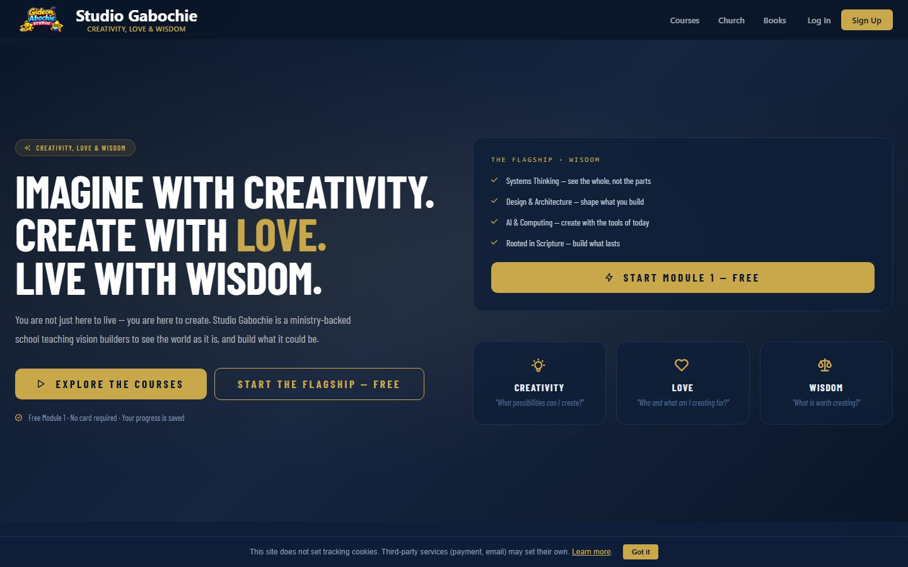
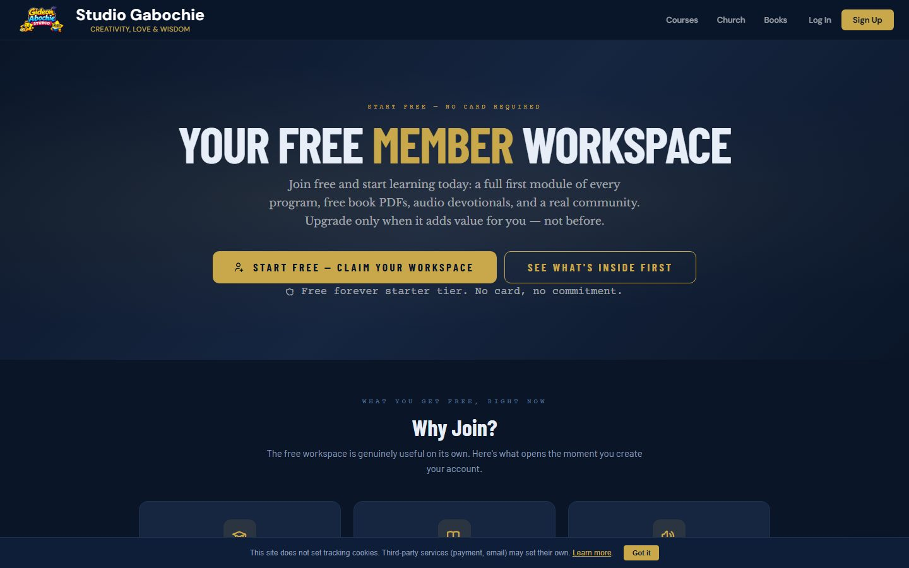
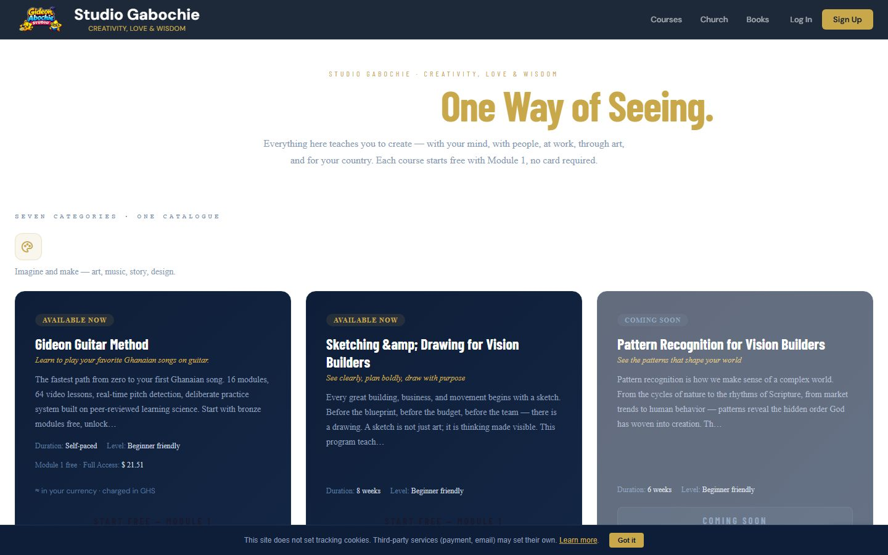
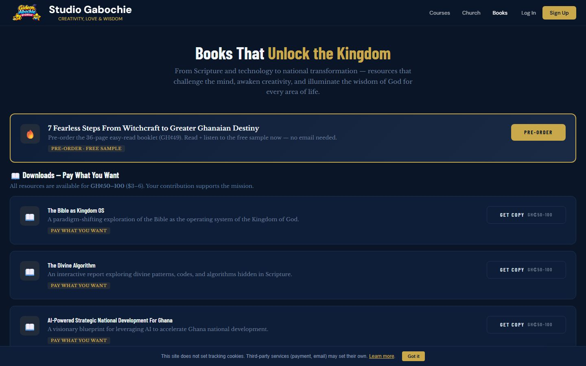
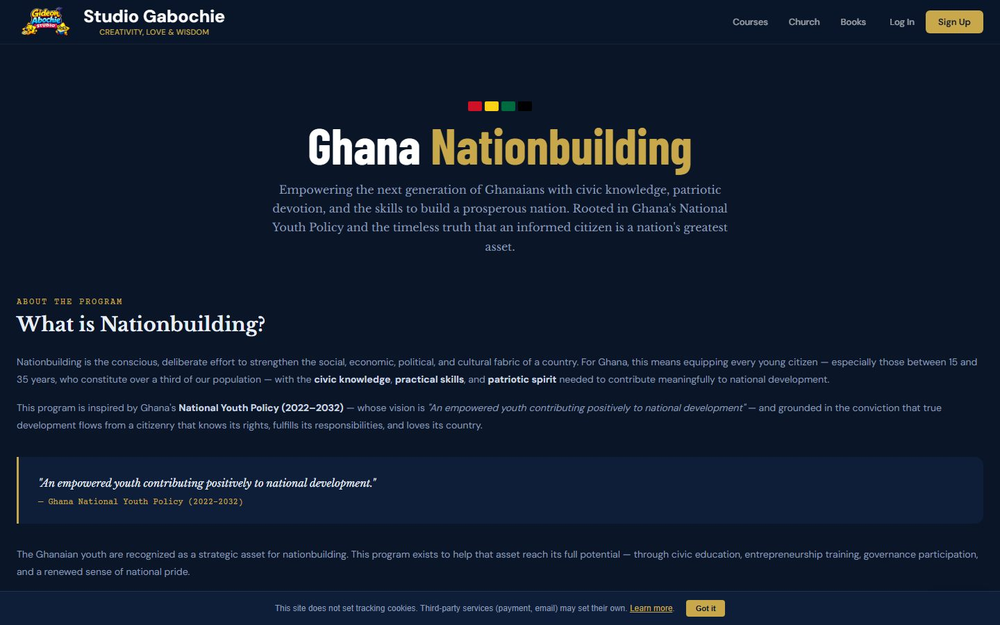

# Studio Gabochie

**What it is:** a full-stack learning and content platform powering the School of
Creativity, Love & Wisdom — online courses, digital books, memberships,
payments, email automation, certificates, student tracking, and gamified learning.
Runs entirely on Cloudflare (Pages Functions + D1 + R2).

**Live:** https://studio.gabochie.com

## Screenshots

| Home | Membership |
| --- | --- |
|  |  |

| School | Books |
| --- | --- |
|  |  |

| Nation Building |
| --- |
|  |

_Live captures from https://studio.gabochie.com (see `scripts/capture-screenshots.mjs`)._

## Features

- **Courses & enrollment** — school/course pages, enrollments, progress tracking, certificates.
- **Digital products** — book sales with R2-backed delivery.
- **Memberships** — tiered, one-time per period (no auto-renewal); renewal reminders via cron.
- **Payments** — ExpressPay (Mobile Money, Ghana Pay, cards), Moolre, NOWPayments crypto, plus manual MoMo and bank-transfer options. Every gateway callback is re-verified server-side before settling.
- **Email automation** — Brevo-driven flows (welcome, receipts, renewals, campaigns) with a signed unsubscribe token.
- **Content & ops** — admin dashboard, contact submissions, event log, CI reports.
- **Optional integrations** — WhatsApp, Eventbrite, Instagram, AI (OpenAI/OpenRouter/Anthropic), Cloudflare Turnstile.

## Pricing

Membership tiers (Ghana Cedis). One-time per period — no auto-renewal; renewal reminders are sent by cron.

| Tier | Monthly | Yearly | Who it's for |
|---|---|---|---|
| Free | ₵0 | ₵0 | Public courses, community forum, email newsletter |
| Supporter | ₵50 | ₵500 | Premium articles & videos, downloadable resources, ad-free |
| Scholar | ₵99 | ₵990 | Full course library, live Q&A, study groups, certificates |
| Patron | ₵299 | ₵2,990 | 1-on-1 mentorship, early access, patron community |
| Founding Partner | — | ₵5,000 | Name on site, private community, co-branded content |

Individual courses are sold separately (one-time): Systems Thinking ₵250, Web Development ₵150, Digital Marketing ₵150, Guitar Method ₵99. Several civic, AI, values, and entrepreneurship programs are free.

## Configuration

Every setting the platform reads is listed in [`.env.example`](.env.example). Copy it to `.dev.vars` for local development, or add the values in Cloudflare Pages → Settings → Environment variables:

```bash
cp .env.example .dev.vars
```

Grouped by purpose: core (public URL + API keys), payments (ExpressPay, Moolre, NOWPayments, manual MoMo/bank), email (Brevo), AI providers, Turnstile, WhatsApp, Eventbrite, Instagram, and access-control secrets. Every value ships blank — nothing sensitive is committed.

## Deploy

This project requires **Cloudflare Pages with Functions + D1 database**.
See [DEPLOY.md](DEPLOY.md) for full setup instructions.

## Development

```bash
npm install    # Install dependencies + install pre-commit hook
npm run dev    # Start local server (requires Cloudflare Pages Functions emulator)
npm test       # Run unit + API tests
npm run check  # Run lint + tests
```

## Project Structure

```
├── functions/         Cloudflare Pages Functions (API endpoints)
│   ├── api/           Public API routes
│   └── admin/        Admin-only API routes
├── tests/             Test suite
│   ├── unit/          Unit tests (vitest)
│   ├── api/           API integration tests (vitest)
│   └── e2e/           E2E tests (Playwright)
├── admin/             Admin dashboard pages
├── books/             Digital books pages
├── school/            School/courses pages
├── support/           Donation/support pages
├── .github/           CI/CD workflows
└── scripts/           Build/utility scripts
```

Developed and maintained by **Gabochie Design** (Tema, Ghana).
