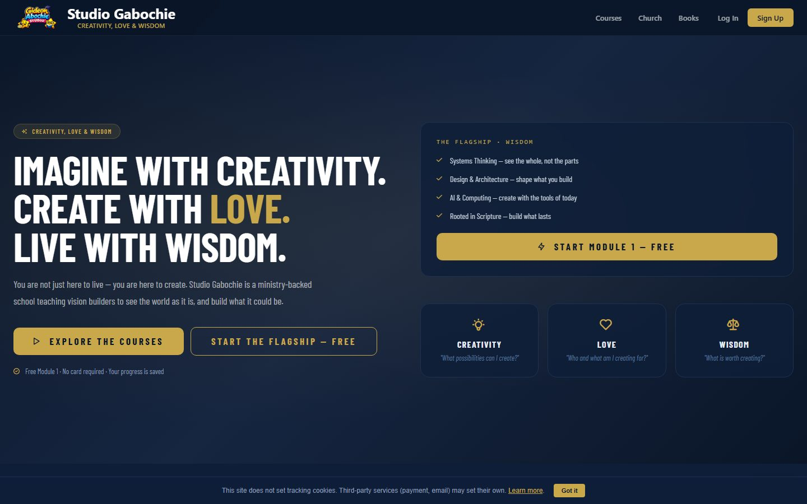
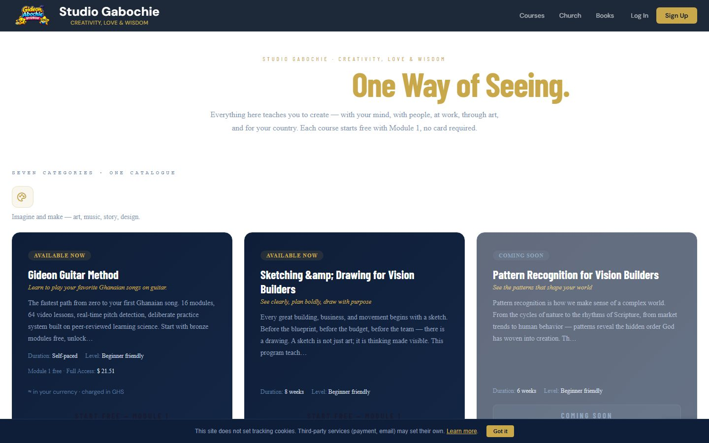
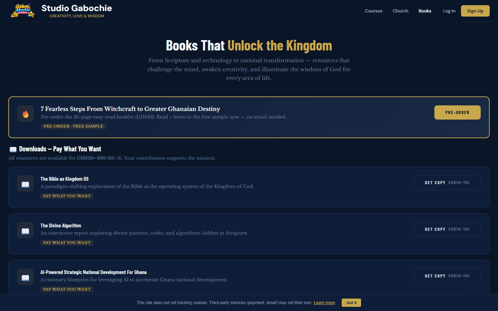
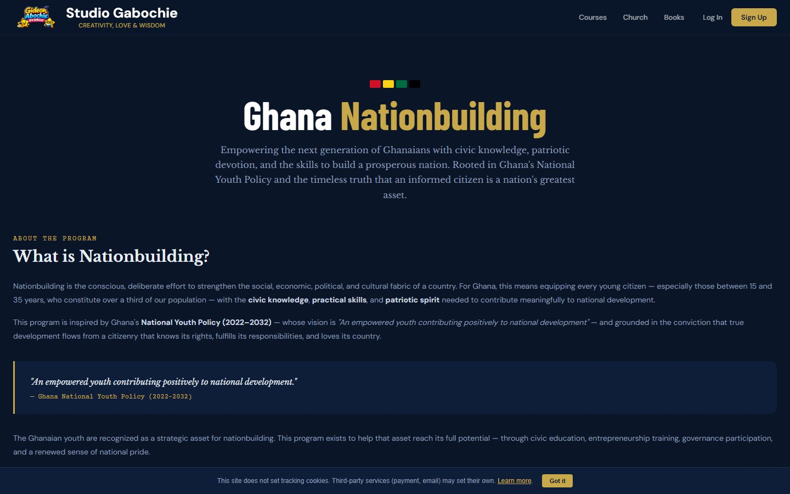

# Studio Gabochie

**What it is:** a full-stack learning and content platform powering the School of
Creativity, Love & Wisdom — online courses, digital books, memberships,
payments, email automation, certificates, student tracking, and gamified learning.
Runs entirely on Cloudflare (Pages Functions + D1 + R2).

**Live:** https://studio.gabochie.com

## Screenshots

| Home | Membership |
| --- | --- |
|  |  |

| School | Books |
| --- | --- |
|  |  |

| Nation Building |
| --- |
|  |

_Live captures from https://studio.gabochie.com (see `scripts/capture-screenshots.mjs`)._

## Features

- **Courses & enrollment** — school/course pages, enrollments, progress tracking, certificates.
- **Digital products** — book sales with R2-backed delivery.
- **Memberships** — tiered, one-time per period (no auto-renewal); renewal reminders via cron.
- **Payments** — ExpressPay (Mobile Money, Ghana Pay, cards), Moolre, NOWPayments crypto, plus manual MoMo and bank-transfer options. Every gateway callback is re-verified server-side before settling.
- **Email automation** — Brevo-driven flows (welcome, receipts, renewals, campaigns) with a signed unsubscribe token.
- **Content & ops** — admin dashboard, contact submissions, event log, CI reports.
- **Optional integrations** — WhatsApp, Eventbrite, Instagram, AI (OpenAI/OpenRouter/Anthropic), Cloudflare Turnstile.
- **High-ticket coaching** — published consultation pricing with optional Selar hosted-checkout links (configured in `assets/js/consultation-config.js`).

## Pricing

Membership tiers (Ghana Cedis). One-time per period — no auto-renewal; renewal reminders are sent by cron.

| Tier | Monthly | Yearly | Who it's for |
|---|---|---|---|
| Free | ₵0 | ₵0 | Public courses, community forum, email newsletter |
| Supporter | ₵50 | ₵500 | Premium articles & videos, downloadable resources, ad-free |
| Scholar | ₵99 | ₵990 | Full course library, live Q&A, study groups, certificates |
| Patron | ₵299 | ₵2,990 | 1-on-1 mentorship, early access, patron community |
| Founding Partner | — | ₵5,000 | Name on site, private community, co-branded content |

Individual courses are sold separately (one-time): Systems Thinking ₵250, Web Development ₵150, Digital Marketing ₵150, Guitar: First Things First ₵299 registration (includes the Bronze foundation; Silver ₵199, Gold ₵299, Apprentice ₵699 full-path unlocks after). Several civic, AI, values, and entrepreneurship programs are free.

Consultation is the high-ticket ladder, booked at `/consultation/`:

| Level | Price | What it is |
|---|---|---|
| Anchor Session | ₵1,500 (~$90) | One 60-minute session + written action notes |
| Coaching Sprint | ₵5,000 (~$300) | Four weekly sessions + action plan |
| Advisory Retainer | ₵10,000/month (~$600) | 2 sessions + async access monthly |

Payment is by MoMo/card after confirmation, or by Selar checkout when a product link is configured. Request-a-slot posts to `/api/services/inquiry`; no sale is settled from a redirect.

**Selar hosted checkout** is also wired into `/donate/` (Show Love / donations), `/books/` (catalogue + bundle), `/courses/` and `/guitar/`. It is a storefront link, not a gateway module — public links live in `assets/js/selar-links.js` (and consultation links in `assets/js/consultation-config.js`), blank links hide their buttons, and no env vars or webhooks are required. Run `npm run check:revenue` to audit which pay links are live (add `--strict` to fail CI when one is missing).

**Revenue dashboard** — `admin/revenue.html` (API: `GET /admin/api/revenue`) combines donations, paid bookings, books, merch, Guitar School and paid courses into one view, with active subscriptions as MRR and consultation leads as pipeline. Only server-re-verified payments count as settled; pending and failed amounts are shown separately, and Selar stays a manual bucket until reconciled. Includes a 12-month chart, lead-source attribution and CSV export.

**Income-guide funnel** — the free `/money-ghana/` assessment and its printable guide now hand off to the consultation ladder. Unlocked users see a priced Anchor Session CTA carrying their top path and profile; `/consultation/` pre-fills the level, track and context from those params and records the `money-ghana-assessment` referral. The day-3 assessment email pitches the same ladder, and those leads surface under "Lead sources" on the revenue dashboard. Pipeline is never counted as revenue.

## Careers

`/careers/` is remote-only (anywhere in the world), contract and part-time first, and publishes pay bands instead of promising open jobs that do not exist. The role catalogue lives in `assets/js/careers-roles.json`; one role is marked open and the rest are a talent pool. Applications post structured fields (role, country, timezone, availability, expected rate, CV and portfolio URLs) to `/api/careers` and are reviewable at `GET /admin/api/careers`. Run `npm run db:setup` after deploying to add the new application columns. Career resources remain at `/careers/resources/`.

## Configuration

Every setting the platform reads is listed in [`.env.example`](.env.example). Copy it to `.dev.vars` for local development, or add the values in Cloudflare Pages → Settings → Environment variables:

```bash
cp .env.example .dev.vars
```

Grouped by purpose: core (public URL + API keys), payments (ExpressPay, Moolre, NOWPayments, manual MoMo/bank), email (Brevo), AI providers, Turnstile, WhatsApp, Eventbrite, Instagram, and access-control secrets. Every value ships blank — nothing sensitive is committed.

## Deploy

This project requires **Cloudflare Pages with Functions + D1 database**.
See [DEPLOY.md](DEPLOY.md) for full setup instructions.

## Development

```bash
npm install    # Install dependencies + install pre-commit hook
npm run dev    # Start local server (requires Cloudflare Pages Functions emulator)
npm test       # Run unit + API tests
npm run check  # Run lint + tests
```

## Project Structure

```
├── functions/         Cloudflare Pages Functions (API endpoints)
│   ├── api/           Public API routes
│   └── admin/        Admin-only API routes
├── tests/             Test suite
│   ├── unit/          Unit tests (vitest)
│   ├── api/           API integration tests (vitest)
│   └── e2e/           E2E tests (Playwright)
├── admin/             Admin dashboard pages
├── books/             Digital books pages
├── school/            School/courses pages
├── support/           Donation/support pages
├── .github/           CI/CD workflows
└── scripts/           Build/utility scripts
```

Developed and maintained by **Gabochie Design** (Tema, Ghana).
